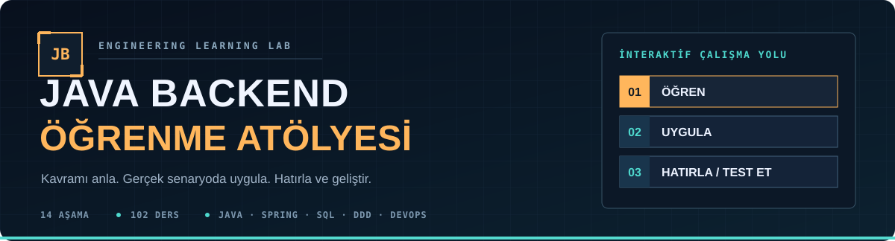
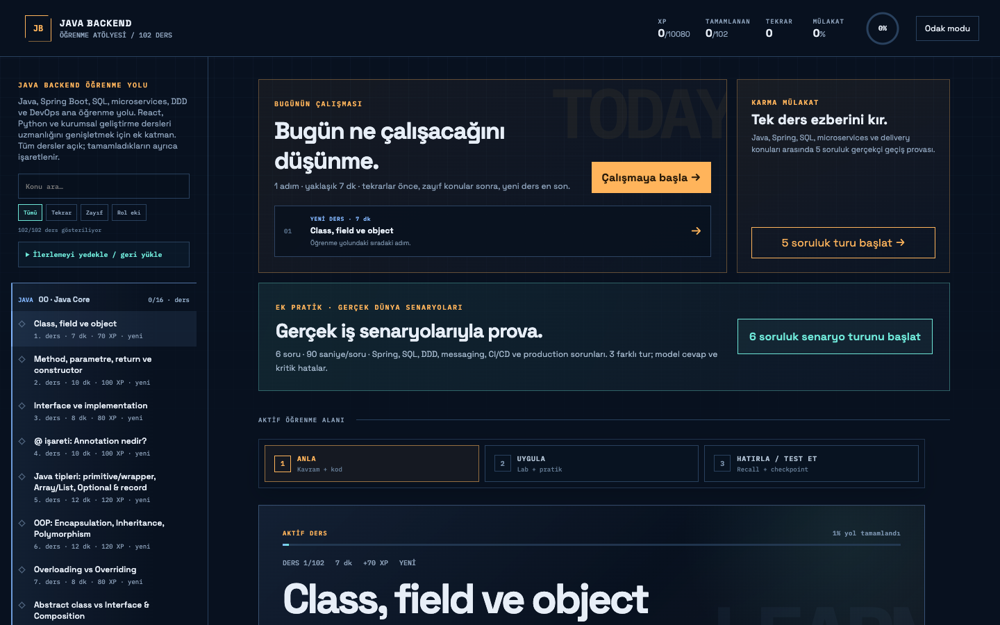
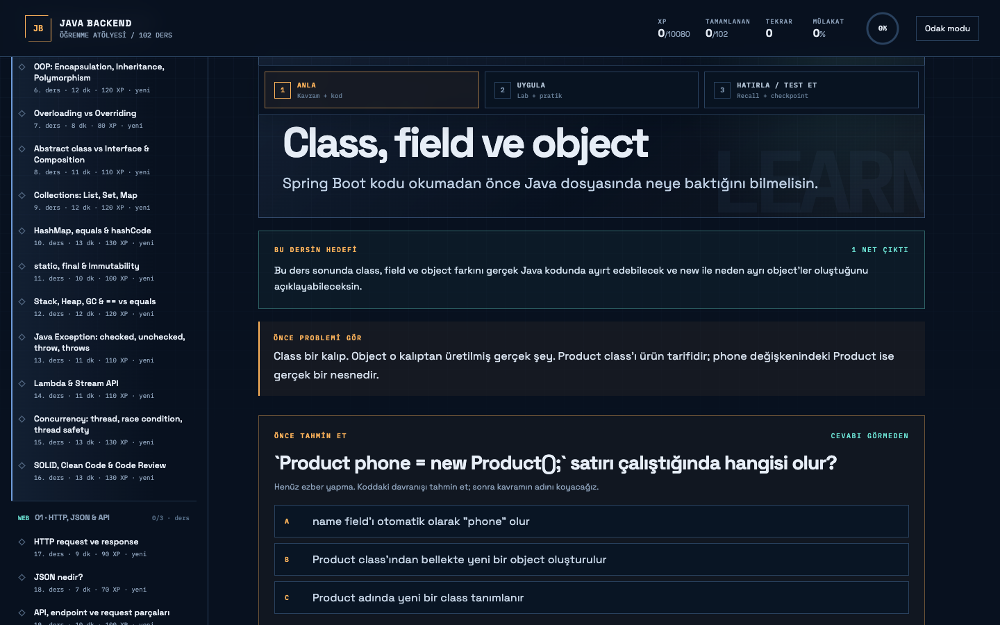
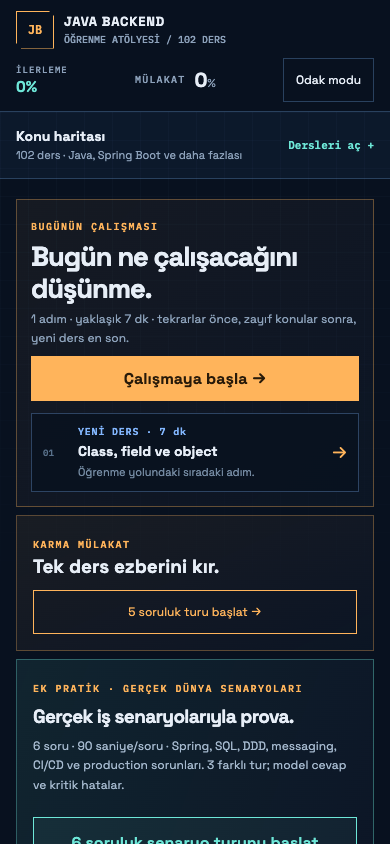
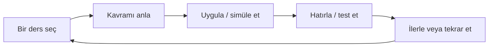
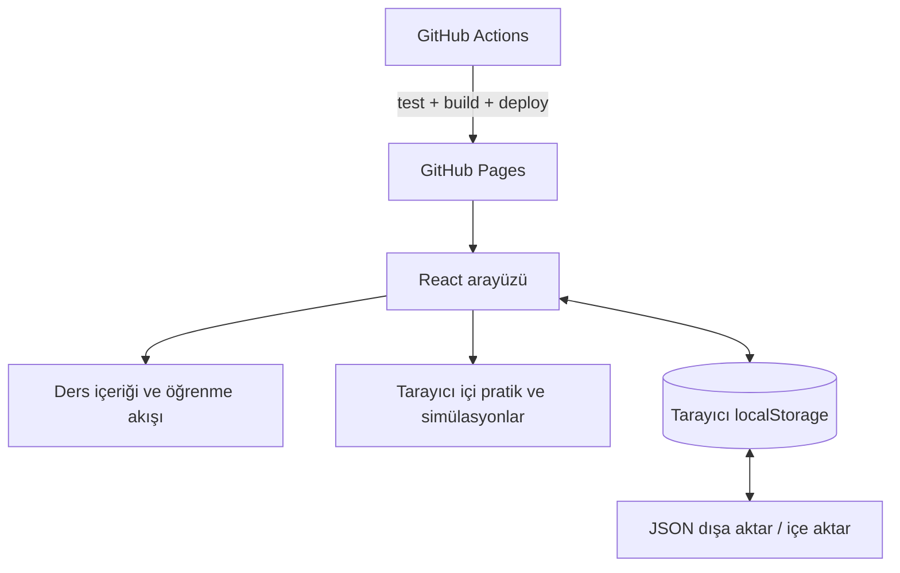

<div align="center">
  

  <h1>Java Backend Öğrenme Atölyesi</h1>

  <p><strong>Java temellerinden production senaryolarına uzanan, Türkçe ve etkileşimli bir yazılım mühendisliği çalışma alanı.</strong></p>

  <p>
    <a href="https://zexy2.github.io/spring-boot-reactor/"><strong>🚀 Canlı uygulamayı aç</strong></a>
    &nbsp;·&nbsp;
    <a href="#quickstart">Yerelde çalıştır</a>
    &nbsp;·&nbsp;
    <a href="#curriculum">Müfredatı incele</a>
  </p>

  <p>
    <a href="https://github.com/zexy2/spring-boot-reactor/actions/workflows/deploy.yml"></a>
    
    
    
  </p>
</div>

> **Projenin kapsamı:** Bu, **React + Vite ile geliştirilmiş bir öğrenme uygulamasıdır**. Java, Spring Boot, SQL, mikroservisler ve DevOps konularını senaryolar ve etkileşimli simülasyonlarla öğretir; arka planda çalışan bir Spring Boot sunucusu, gerçek veritabanı veya bulut altyapısı kurmaz.

<a id="screenshots"></a>
## Uygulamadan görüntüler

Gerçek, yayındaki uygulamadan alınmış ekran görüntüleri:



<div align="center">
  
  
</div>

<a id="features"></a>
## Neler yapabilirsin?

| Alan | Uygulamadaki deneyim |
| --- | --- |
| **Yol haritası** | 14 aşamadaki 102 dersi keşfet; konu ara, filtrele ve kaldığın yerden devam et. Ders bağlantısını paylaş, tarayıcıda geri/ileri git. |
| **Yönlendirmeli öğrenme** | Kavramı öğren → uygula → hatırla/test et akışıyla ilerle. |
| **Etkileşimli pratik** | Kod alıştırmaları, hata ayıklama görevleri ve konuya özel etkileşimli simülasyonlar yap. |
| **Sistem düşüncesi** | DDD, API Gateway, servisler arası iletişim, dayanıklılık, Docker, Kubernetes ve CI/CD gibi kavramları senaryolarla incele. |
| **Mülakat çalışması** | Karma mülakat turları ve iş ortamından uyarlanmış teknik senaryolarla kendini sına. |
| **Öğrenme takibi** | Tamamlanan dersleri, tekrar gereksinimini ve ilerlemeni izle; çalışmanı JSON olarak yedekle. |

### Bir çalışma oturumu nasıl ilerler?



Kod pratiği ve laboratuvarlar, ilgili kavramı anlamayı hedefleyen **tarayıcı içi alıştırmalardır**. Gerçek bir Java derleyicisi, canlı mikroservis ağı veya Kubernetes kümesi yerine geçmez.

<a id="curriculum"></a>
## 14 aşamalı öğrenme yolu

Müfredat, temel sözdiziminden kurumsal uygulama tasarımına uzanır. Dersler tek bir uzun makale yerine küçük çalışma adımlarına bölünmüştür.

| Temeller ve uygulama geliştirme | Mimari ve teslim süreçleri |
| --- | --- |
| **00** · Java Core | **07** · Production Readiness & Performance |
| **01** · HTTP, JSON & API | **08** · SDLC, Agile & Documentation |
| **02** · Spring Boot Core | **09** · DDD Foundations & Microservices |
| **03** · Spring Web & REST | **10** · DDD Services & System Design |
| **04** · SQL, JPA & Transactions | **11** · DevOps & CI/CD |
| **05** · Errors, Config & Logging | **12** · React & Python Awareness |
| **06** · Testing & Security | **13** · Enterprise & Behavioral Interview |

**Öne çıkan çalışma konuları:** Java OOP ve koleksiyonlar; Spring katmanları ve REST sözleşmeleri; JPA ve transaction sınırları; test ve güvenlik; mikroservis desenleri, asenkron mesajlaşma ve Saga; domain sınırları; release, rollback ve CI/CD kararları.

<a id="quickstart"></a>
## Hızlı başlangıç

**Gereksinimler:** [Node.js 22](https://nodejs.org/) ve npm. Java JDK, Maven, Docker veya bir veritabanı **uygulamayı açmak için gerekli değildir**.

```bash
git clone https://github.com/zexy2/spring-boot-reactor.git
cd spring-boot-reactor
npm ci
npm run dev
```

Terminalin gösterdiği yerel adrese (genellikle `http://localhost:5173`) git. Canlı sürümü denemek için kurulum yapmana gerek yok: **[Uygulamayı tarayıcıda aç](https://zexy2.github.io/spring-boot-reactor/)**.

**Kısayollar ve paylaşım:** Ders dışındaki alanlarda `j` sonraki, `k` önceki derse geçer. Ders haritasındaki bağlantıları yeni sekmede açabilirsin. Her dersin **Bağlantıyı kopyala** düğmesi, `?lesson=...` parametreli paylaşılabilir URL oluşturur. Bağlantıyı açan kişi doğrudan o derse yönlenir; kişisel ilerleme verileri paylaşılmaz.

| Komut | İşlevi |
| --- | --- |
| `npm run dev` | Vite geliştirme sunucusunu açar. |
| `npm test` | Projenin Node.js testlerini çalıştırır. |
| `npm run build` | Üretim dosyalarını `dist/` dizinine oluşturur. |
| `npm run preview` | Oluşturulmuş üretim çıktısını yerel olarak önizler. |
| `npm run test:e2e` | Derlenmiş GitHub Pages sürümünü masaüstü ve mobil Chromium'da sınar. Öncesinde `DEPLOY_GITHUB_PAGES=true npm run build` çalıştır. İlk kullanımda `npx playwright install chromium` gerekir. |

<a id="architecture"></a>
## Nasıl çalışıyor?



| Konum | Sorumluluk |
| --- | --- |
| `src/data/` | Ders içeriği, mülakat ve senaryo verileri. |
| `src/components/learning/` | Ders, kod pratiği, hata ayıklama, hatırlama, mülakat ve yedekleme arayüzleri. |
| `src/learning/` | Öğrenme durumu, alıştırma mantığı ve kavrama özel simülasyonlar. |
| `src/Post05Playgrounds.jsx` | İleri konuların etkileşimli çalışma alanları. |
| `tests/` | Öğrenme mantığı ve simülasyonları doğrulayan otomatik testler. |
| `.github/workflows/deploy.yml` | `main` dalındaki değişikliklerin test edilmesi, derlenmesi ve GitHub Pages'e dağıtılması. |

**Teknoloji:** React, Vite, JavaScript, `java-parser`, Motion ve Node.js test çalıştırıcısı. GitHub Pages üzerinden statik olarak yayımlanır. Üretim derlemesinde Vite taban yolu `/spring-boot-reactor/` olarak ayarlanır.

<a id="progress"></a>
## İlerleme ve verilerin

İlerleme verileri tarayıcının **`localStorage`** alanında tutulur. Kullanıcı hesabı veya sunucu tarafında senkronizasyon bulunmaz.

- **Yedekle:** Sol menüdeki **“İlerlemeyi yedekle / geri yükle”** bölümünden **“JSON indir”** seçeneğini kullan.
- **Geri yükle:** İndirdiğin JSON dosyasını seç; mevcut verilerle **birleştirme** veya **yerine koyma** seçeneğini ihtiyacına göre belirle.
- **Birden fazla sekme:** İlerleme aynı tarayıcıda farklı sekmelerde değişirse eski sekmede otomatik kayıt durur. O sekmede ek çalışma yaptıysan uyarıdan JSON yedeğini indir, sayfayı yenile ve **Birleştir** moduyla geri al. Çakışma koruması tarayıcı `localStorage` kısıtları nedeniyle çok yakın eşzamanlı yazımlarda mutlak garanti vermez.
- **Cihaz/tarayıcı değiştirirken:** Önce yedek al. `localhost` ile GitHub Pages farklı tarayıcı kökenleri olduğundan ilerlemeleri kendiliğinden paylaşmaz.

Tarayıcı verilerini temizlemek ilerlemeni silebilir. Yedeği güvenli bir yerde sakla; içe aktarmadan önce hangi geri yükleme modunu seçtiğini kontrol et.

<a id="contributing"></a>
## Katkı ve geri bildirim

Bir dersin teknik açıklaması hatalıysa, simülasyon beklenmedik davranıyorsa veya bir erişilebilirlik sorunu görüyorsan [GitHub Issues](https://github.com/zexy2/spring-boot-reactor/issues) üzerinden bildir. Değişiklik önermek için bir branch oluşturup pull request gönderebilirsin. Özellikle **tekrarlanabilir hata adımları** ve **kaynakla desteklenen teknik düzeltmeler** değerlidir.

Kodun herkese açık olması, otomatik olarak açık kaynak kullanım lisansı verildiği anlamına gelmez. Bu depoda şu anda ayrı bir `LICENSE` dosyası bulunmuyor.

---

<div align="center">
  <strong>Öğren → Uygula → Hatırla → İyileştir</strong><br />
  <sub>Gerçek dünya mühendislik kararlarını öğrenmek için hazırlanmış etkileşimli çalışma alanı.</sub><br /><br />
  <a href="https://zexy2.github.io/spring-boot-reactor/"><strong>Çalışmaya başla ↗</strong></a>
</div>
